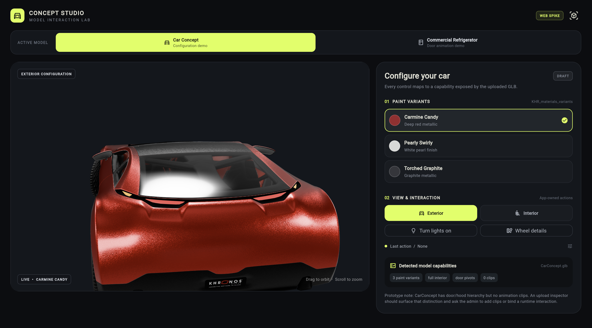
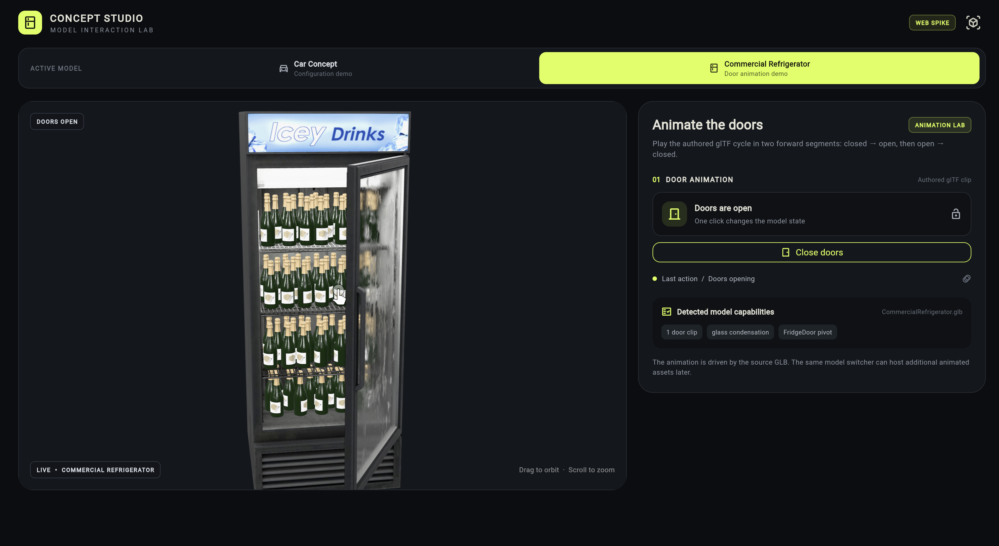

# Car Concept Studio

Car Concept Studio is a small Flutter Web prototype for exploring how a product
configurator can inspect and interact with real glTF/GLB model capabilities.

It is a preview build for friends, designers, and developers to try. The goal
is to test the interaction model—not to present a finished production product.

**Live preview:** [Open Car Concept Studio](https://abdullahalamodi.github.io/car_concept_studio/)

## Preview

<table>
  <tr>
    <td align="center">
      
      <br>
      <sub>Car Concept: paint variants, views, lights, and model capability details.</sub>
    </td>
    <td align="center">
      
      <br>
      <sub>Commercial Refrigerator: an authored door animation with open and close controls.</sub>
    </td>
  </tr>
</table>

## What it does

- Switches between a Car Concept model, a Commercial Refrigerator model, and a
  Scene Lab built on `flutter_scene`.
- Demonstrates three authored `KHR_materials_variants` paint options on the car.
- Provides exterior and interior camera presentations for the car.
- Exposes model-specific actions such as headlights and wheel details.
- Anchors tappable information points to the front wheels and doors as the car
  rotates; Show all info opens the complete parts overview.
- Describes the concept asset without inventing unavailable vehicle specifications.
- Plays the refrigerator's authored glTF door animation forward and backward.
- Runs the Scene Lab: per-part painted PBR finishes, live studio lighting looks,
  spinning wheels, authored camera shots, and an auto-choreographed showreel.
- Shows a capability summary based on the selected GLB asset.

The controls are intentionally model-aware: the interface surfaces capabilities
that exist in the selected asset instead of assuming every model supports the
same interactions.

## Run locally

You need the Flutter SDK and a modern web browser.

```bash
git clone https://github.com/abdullahalamodi/car_concept_studio.git
cd car_concept_studio
flutter pub get
flutter run -d chrome
```

To build the release version:

```bash
flutter build web --release
```

The static release bundle is generated in `build/web`. To preview that bundle
through a local web server:

```bash
python3 -m http.server 8000 --directory build/web
```

Then open <http://localhost:8000>.

## Deploy from GitHub

The repository includes a GitHub Actions workflow at
`.github/workflows/deploy-web.yml`. It builds and deploys the web app to GitHub
Pages whenever changes are pushed to `main`.

One-time setup:

1. Open the repository's **Settings → Pages** page.
2. Set **Build and deployment → Source** to **GitHub Actions**.
3. Push changes to `main`, or run the workflow manually from the **Actions** tab.

After that, GitHub rebuilds the app for you—there is no need to upload
`build/web` manually after each change.

If the workflow reports `Get Pages site failed`, return to **Settings → Pages**
and select **GitHub Actions** as the source. Pages must be enabled once before
the standard `GITHUB_TOKEN` can deploy the site.

## Project status

This is a web spike/prototype. It currently uses local GLB assets and does not
have a backend, authentication, database, or server-side engine.

The 3D models are loaded in the browser, so the first load can take a little
time. The public deployment is intended for testing and feedback.

## Asset attribution

The 3D assets come from the Khronos glTF Sample Assets repository and are
licensed under CC BY 4.0. Keep the attribution when using this project beyond
local testing:

- [CarConcept attribution](https://github.com/KhronosGroup/glTF-Sample-Assets/blob/main/Models/CarConcept/README.md)
- [CommercialRefrigerator attribution](https://github.com/KhronosGroup/glTF-Sample-Assets/blob/main/Models/CommercialRefrigerator/README.md)
